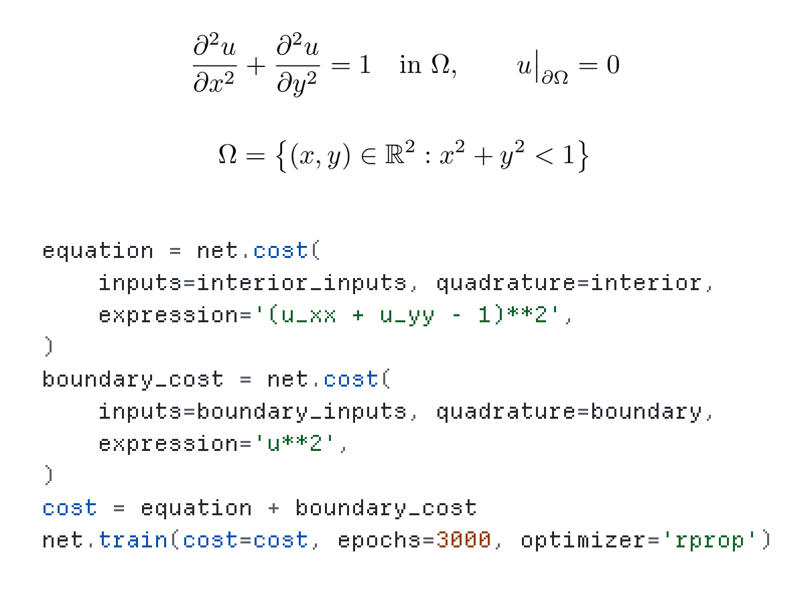
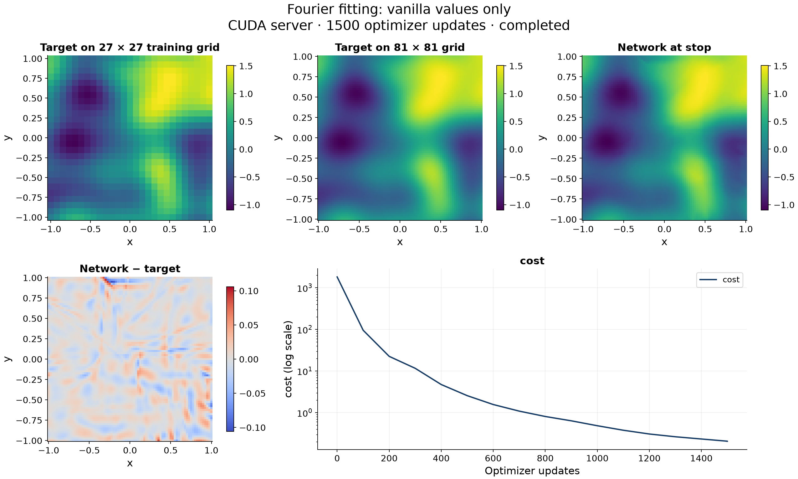
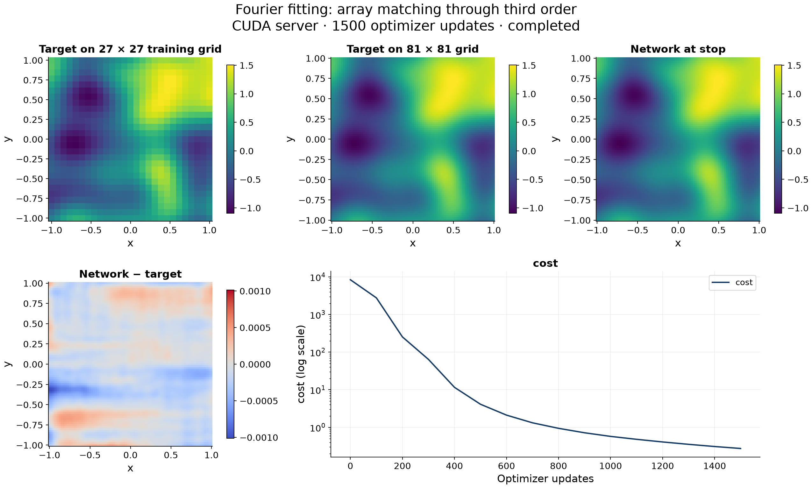
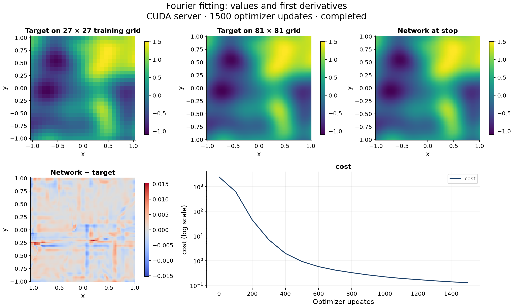
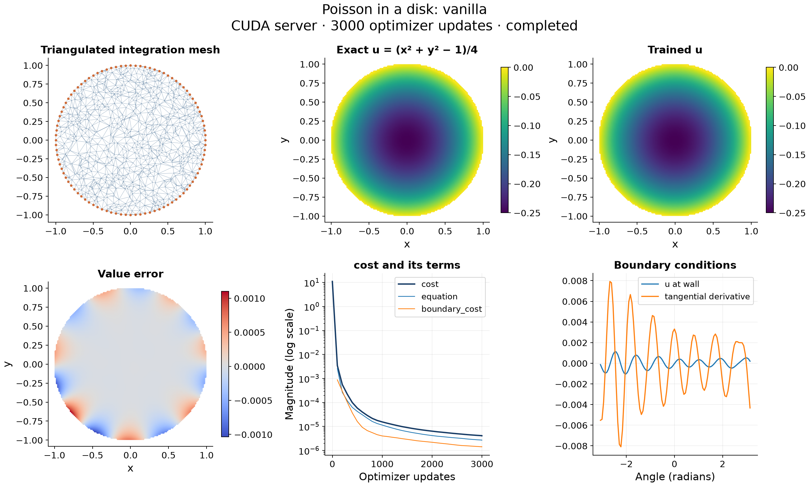
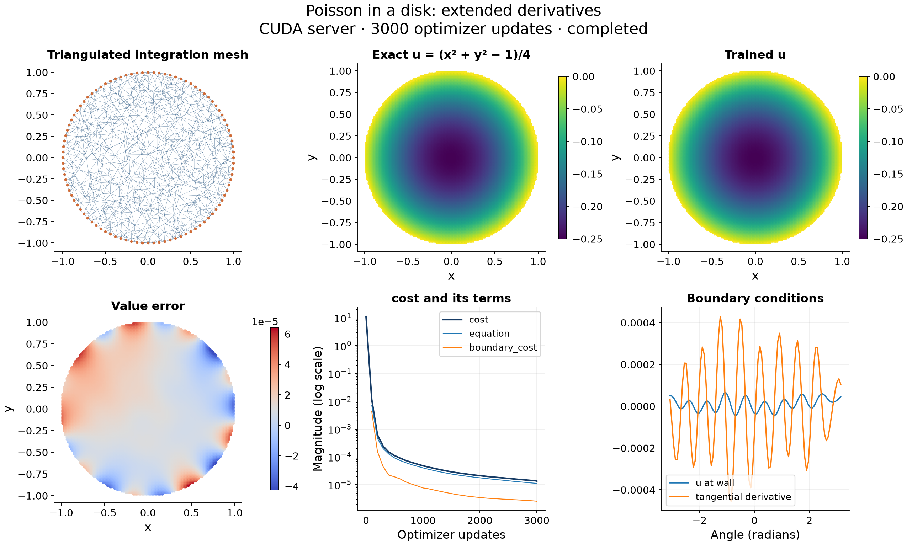
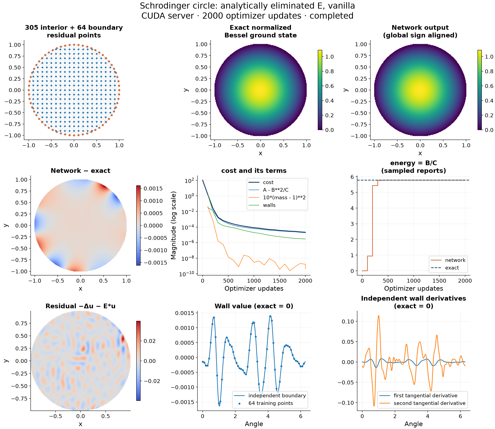
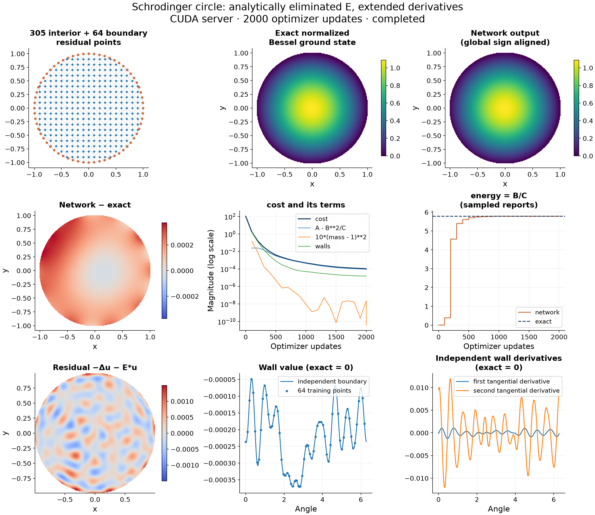

# cPDE: CUDA-Efficient High-Order Derivative Training

*An easy-to-use Python interface for forward and backward propagation with derivatives through sixth order, including mixed derivatives. CUDA and CPU backends.*



The [Poisson disk example](examples/poisson_disk_vanilla.py) supplies the inputs
and quadrature used above. [Walk through the cost and training calls](#poisson-disk).

Currently, **only fully connected multilayer perceptrons (MLPs)** are supported.

Forward mode computes network values and their requested input
derivatives; backward mode computes weight gradients for objectives involving
those quantities. This supports both function approximation and PDE residual
minimization, with CUDA and CPU execution.

The derivative-training method is described in V. I. Avrutskiy,
[**Enhancing Function Approximation Abilities of Neural Networks by Training
Derivatives**](https://doi.org/10.1109/TNNLS.2020.2979706),
*IEEE Transactions on Neural Networks and Learning Systems*.
An [open-access preprint](https://arxiv.org/abs/1712.04473) is also available.

Python describes data, derivatives, quadrature and costs, then connects to a
separately built executable for the lifetime of a `Session`. The executable owns
its memory and runs every term, chunk, backward pass and optimizer update. Python
receives reports and checkpoints; it does not run the epoch loop.

The CPU and CUDA backends share the network, derivative and optimizer code. CUDA
compiles scalar expression kernels with NVRTC; CPU evaluates the same validated
instructions with an interpreter. See [integral costs and quadrature](API_REFERENCE.md#integral-costs-and-quadrature).
This repository is MIT licensed.

**AI-use disclosure:** the supplied numerical derivative core predates this
AI-assisted development. Much of the Python wrapper, persistent server, CPU
backend, examples, tests and documentation was implemented or revised with
OpenAI Codex; the retained engine also received targeted edits. See
[code provenance](CODE_PROVENANCE.md) for the component-by-component distinction.

## Function approximation benchmark

Measured on an **RTX 3090 (24 GB)** with 729 points and a
`2 → 128 → 128 → 128 → 128 → 1` sigmoid MLP. Each order includes all mixed
derivatives through that order; arithmetic is float32 with TF32 disabled.

The unmodified **cPDE CUDA server compiled and linked in 19.3 seconds**
(26.5 seconds including clean CMake configuration) on an Intel
Core i7-9750H, using CUDA 13.0.88 and MSVC. This server build covers all orders
0–6; the array-matching loss below requires no per-order runtime compilation.

An epoch in this table means **forward evaluation, loss and weight-gradient
computation**, at fixed weights. Optimizer updates, data transfers and production
training diagnostics are excluded. Values are medians of seven synchronized batches.

“Extra derivatives” counts all distinct partial derivatives through the selected order, excluding the function value.

| Order | Extra derivatives | PyTorch, no JIT (ms/epoch) | PyTorch + JIT (ms/epoch) | cPDE CUDA (ms/epoch) | JIT compilation time (s) |
|---:|---:|---:|---:|---:|---:|
| 0 | 0 | 1.45 | 0.84 | 0.41 | 8.8 |
| 1 | 2 | 2.73 | 1.50 | 0.68 | 11.8 |
| 2 | 5 | 8.06 | 3.09 | 1.10 | 18.5 |
| 3 | 9 | 26.71 | 7.51 | 1.72 | 44.3 |
| 4 | 14 | 90.09 | 25.74 | 2.40 | 175.9 |
| 5 | 20 | 317.55 | 47.49 | 3.59 | 509.9 |
| 6 | 27 | 1,092.37 | 161.08 | 5.65 | 2,649.7 |

JIT uses PyTorch `torch.compile` with Inductor/Triton. Its compilation time is
measured with an empty cache for each order and includes graph capture and the
first execution. The ms/epoch columns exclude compilation. PyTorch version:
`2.11.0+cu128`; OS: Windows.

See [methodology, raw timings and reproduction](docs/benchmarks/fourier-rtx3090.md),
including [actual public `net.train` timings](docs/benchmarks/fourier-rtx3090.md#public-training-api),
which also include RPROP updates and safety checks.

## Build locally

The release contains source and no prebuilt server executable. CPU builds need
CMake and a C++17 compiler. CUDA builds also need locally installed CUDA with
cuBLAS and NVRTC.

| Platform | CPU build | CUDA build |
|---|---|---|
| macOS, including Apple Silicon | `sh scripts/build-macos.sh` | — |
| Linux | `sh scripts/build-linux.sh cpu` | `sh scripts/build-linux.sh cuda` |
| Windows developer PowerShell | `./scripts/build-windows.ps1 -Backend cpu` | `./scripts/build-windows.ps1 -Backend cuda` |

macOS uses Accelerate for CPU matrix operations. Other CPU builds use system CBLAS
when found, with a portable serial fallback. Linux/Windows can build both backends.
See [build instructions](BUILDING.md) for prerequisites, output paths and options.

## Select a session

Install the Python package with `python -m pip install .`. Pass the executable path
explicitly; `backend` verifies that it is the requested kind:

```python
from cpde import Session

with Session('/path/to/cpde_cpu_server', backend='cpu') as session:
    print(session.backend)  # cpu
```

For CUDA, use `Session('/path/to/cpde_server', backend='cuda', device=0)`.
Omitting `backend` with an explicit path detects it from the server handshake.
CPU accepts only `device=0`.

For `Session(backend='cpu')`, set `CPDE_CPU_SERVER` or put `cpde_cpu_server` on PATH.
For `Session(backend='cuda')` or `Session()`, set `CPDE_SERVER` or put `cpde_server`
on PATH. Python never builds a server or silently changes the requested backend.

## Guide to the examples

These walkthroughs follow the delivered scripts: Fourier fitting, Poisson in a
disk, the circle Schrödinger problem, and an attached variation. Each training
problem has a vanilla version and a version with extra derivative penalties.
The optional explicit fitting example shows another way to express a matching cost.
Ordinary NumPy/SciPy preparation is left to the source; the guide explains what
its arrays mean to cPDE.

Code blocks show the relevant portions of each script. The **Calls explained**
links immediately below them lead to the explanation of that particular use.
They work in GitHub Markdown; short link titles also provide hover hints in
viewers that support them. Follow the source link for the complete runnable script.

| Example | Vanilla source | Extended source | Training updates |
|---|---|---|---:|
| [Fourier fitting](#fourier-fitting) | [values](examples/fit_function_vanilla.py) | [through third derivatives](examples/fit_function.py) | 1500 |
| [Poisson disk](#poisson-disk) | [PDE and wall values](examples/poisson_disk_vanilla.py) | [residual and wall derivatives](examples/poisson_disk.py) | 3000 |
| [Schrödinger circle](#schrodinger-circle) | [PDE and wall values](examples/schrodinger_circle_vanilla.py) | [residual and wall derivatives](examples/schrodinger_circle.py) | 2000 |
| [Attached variation](#attached-variation) | [moving ellipse](examples/attached_variation.py) | — | No training |
| [Explicit fitting cost](#explicit-fitting) | [values and first derivatives](examples/fit_function_explicit.py) | — | 1500 |

## Run the examples

Install the matching cPDE 0.2.0 package from its source checkout with
`python -m pip install '.[geometry]'`. The scripts use NumPy and SciPy and require
a matching CPDE/3 CPU or CUDA server. CUDA builds need NVRTC for expression
costs; the CPU backend interprets those expressions without CUDA. The samples archive contains the scripts, guide and figures;
it does not contain the library or server.

From the repository root or extracted samples directory:

```sh
export CPDE_SERVER=/absolute/path/to/cpde_server
python -m examples.fit_function_vanilla
python -m examples.fit_function
python -m examples.poisson_disk_vanilla
python -m examples.poisson_disk
python -m examples.schrodinger_circle_vanilla
python -m examples.schrodinger_circle
python -m examples.attached_variation
python -m examples.fit_function_explicit
```

On PowerShell, use `$env:CPDE_SERVER = 'C:\path\cpde_server.exe'`. To run on CPU,
point the same example variable at `cpde_cpu_server` instead. The supplied path
determines the backend. See the [platform build instructions](BUILDING.md).
The scripts print progress and their final arrays. The figures below come from
separate validation runs; running a sample does not generate a plot.

<a name="data-contract"></a>
## Reading the inputs and derivative schemas

Every `Data` array has shape **(derivative row, channel, sample)**. A schema row
`(order, x count, y count)` describes the derivative stored at that row. A
value-only array uses `[[0, 0, 0]]`; there are no derivative rows in that array.
Input channels are the network's features. In the first three problems they are
`x` and `y`; in the attached-variation example they are `x**2` and `y**2`.

<a name="interior-schema"></a>
### What `interior_derivatives` and `interior_schema` mean

```python
interior_derivatives = ['xx', 'yy']
interior_schema = table(interior_derivatives, variables='xy')
```

**Calls explained:** [`table(...)`](#table-call "Expand the requested derivatives into the rows needed for propagation").

`interior_derivatives` is an ordinary Python list naming the output derivatives
needed by the interior cost. The strings describe differentiation with respect
to spatial variables, so `'xx'` means two x derivatives. The variable name
`interior_derivatives` has no special meaning to the library.

<a name="table-call"></a>
`table(requests, variables='xy')` returns integer **metadata**, including values
and all lower dependencies. `interior_schema` is that returned array. It controls
the row layout when constructing interior `Data`. It neither contains numerical
derivatives nor differentiates the supplied samples. With `variables='xy'`, its
columns are `(order, x count, y count)` and rows are sorted by total order, then
by the count tuple. Consequently y precedes x:

| Row | `table(['xx', 'yy'], variables='xy')` | Output component |
|---:|---|---|
| 0 | `(0, 0, 0)` | `u` |
| 1 | `(1, 0, 1)` | `u_y` |
| 2 | `(1, 1, 0)` | `u_x` |
| 3 | `(2, 0, 2)` | `u_yy` |
| 4 | `(2, 2, 0)` | `u_xx` |

There is no `u_xy` row in this request. Requesting
`['xxx', 'xxy', 'xyy', 'yyy']` gives all ten rows through order three, in order:
`u, u_y, u_x, u_yy, u_xy, u_xx, u_yyy, u_xyy, u_xxy, u_xxx`.
Requesting `['xx', 'xy', 'yy']` gives the first six of those rows;
`['x', 'y']` gives the first three. Request order does not set row order.
`u_xy` and `u_yx` name the same derivative.

For coordinate inputs, the value row stores `(x, y)`, the x derivative row stores
`(1, 0)`, the y derivative row stores `(0, 1)`, and higher input derivatives are
zero. Those zeros describe the coordinate features, **not** the network output.
The nonlinear network propagates the supplied feature derivatives and produces
its own, generally nonzero, higher output derivatives.

<a name="session-data-network"></a>
### Session, data and network names

```python
with Session(os.environ['CPDE_SERVER']) as session:
    inputs = Data(samples, schema, session=session).name_variables('xy')
    net = Network([2, 128, 128, 128, 128, 1], session=session).name_outputs('u')
```

**Calls explained:** [`Session`](#session-call "Launch the persistent CPU or CUDA server"),
[`Data` and `name_variables`](#data-call "Upload feature values and their spatial derivatives"),
[`Network` and `name_outputs`](#network-call "Create the network and name its output u").

<a name="session-call"></a>
`Session(executable)` launches the supplied server and detects its backend.
`session.backend` reports `cpu` or `cuda`. The session owns the server objects: CPU
memory for the CPU executable, GPU memory for the CUDA executable. For applications
that discover the executable instead of passing a path, `Session(backend='cpu')`
uses `CPDE_CPU_SERVER` or `cpde_cpu_server` on PATH; `backend='cuda'` uses
`CPDE_SERVER` or `cpde_server` on PATH. An explicit selection must match the server.
All objects participating in a cost use the same `session`. The context manager
releases them and stops the server on exit. `net.train` sends one training request;
the server executes its epochs without a Python epoch loop.

<a name="data-call"></a>
`Data(samples, schema, session=session)` uploads the numerical array and its row
metadata. `.name_variables('xy')` names the differentiation variables used by the
schema's count columns. It does not generate coordinates or derivatives, and it
does not mean the input features must themselves be x and y. Targets use the same
contract, with output channels instead of input features.

<a name="network-call"></a>
`Network([2, 128, 128, 128, 128, 1], session=session)` creates two input channels,
four hidden layers of width 128 with sigmoid activations, and one linear output
channel. `.name_outputs('u')`
names that output for expressions such as `u_xx`. These names are separate from
the differentiation variables. Initial weights are generated by the Python
wrapper with NumPy and uploaded to the device. The examples leave network
initialization unseeded; their seeded geometry or target generation does not seed
the network. Pass `seed=42` to `Network` when repeatable initialization is wanted.

<a name="evaluation-call"></a>
### Reading an evaluated network

```python
prediction = net.eval(inputs)
values = prediction.to_numpy()
prediction.close()
```

**Calls explained:** [`net.eval`](#eval-meaning "Evaluate all rows of this input schema"),
[`to_numpy` and `close`](#download-meaning "Download the result and release its server allocation").

<a name="eval-meaning"></a>
`net.eval(inputs)` returns a new server-owned `Data` object containing the network output
in the public row order of `inputs`. With one named output, the shape is
`(len(schema), 1, number_of_samples)`. This is evaluation at the supplied samples;
it does not create a denser grid or compute the cost. The result remains valid
after another evaluation.

<a name="download-meaning"></a>
`.to_numpy()` downloads a detached host array. Changing it does not change the
server object. `.close()` releases the prediction's allocation; the downloaded
array remains usable. Use the supplied schema to identify each output row; the derivative examples
also print their schema alongside the arrays.

<a name="fourier-fitting"></a>
## 1. Fourier fitting

The target is a two-dimensional Fourier sum with frequencies 1–10 and 400 fixed
coefficients. Both main scripts use the same 27 × 27 training grid on $[-1,1]^2$
and the four-hidden-layer network introduced above.

### Vanilla: match values

Source: [fit_function_vanilla.py](examples/fit_function_vanilla.py).
The schema contains only `(0, 0, 0)`. Inputs have shape `(1, 2, 729)` and targets
have shape `(1, 1, 729)`. No derivatives are generated or passed to cPDE.

```python
inputs = Data(samples, schema, session=session).name_variables('xy')
targets = Data(target_values, schema, session=session).name_variables('xy')
net = Network([2, 128, 128, 128, 128, 1], session=session).name_outputs('u')
cost = net.cost(inputs=inputs, targets=targets, weights=weights,
                name='array matching')
net.train(cost=cost, epochs=1500, optimizer='rprop', reset_steps=2e-4,
          verbose=2, log_every=100)
```

**Calls explained:** [`Data`](#fourier-data "Feature and target shapes for fitting"),
[`Network`](#network-call "Four hidden layers of width 128"),
[`net.cost`](#fourier-cost "Weighted squared matching errors, summed over samples"),
[`net.train`](#fitting-train "1500 RPROP updates and reporting settings").

<a name="fourier-data"></a>
The input and target `Data` objects share a schema and sample ordering. Target
channel 0 corresponds to network output 0. `name_variables('xy')` on both objects
makes the derivative-variable correspondence explicit; it does not name the
target channel `u`.

<a name="fourier-cost"></a>
`net.cost(inputs=..., targets=..., weights=..., name=...)` creates a matching cost:

$$
\mathrm{cost}=\sum_{i=1}^{729} w\,[u(x_i,y_i)-f(x_i,y_i)]^2,
\qquad w=\frac{1}{\mathrm{std}(f)^2}.
$$

Here `weights` has shape `(1, 1)`: one output, one derivative row. Its entries
multiply squared errors directly. `inputs` supplies the evaluation data;
`targets` supplies the desired output values. `name='array matching'` labels the
cost in reports. No quadrature is supplied, so this is a sum over samples,
without an automatic mean or area factor.

<a name="fitting-train"></a>
`net.train` minimizes the supplied `cost`. `epochs=1500` requests 1500 optimizer
updates, each using the complete cost. `optimizer='rprop'` selects RPROP;
`reset_steps=2e-4` assigns that initial per-weight step size and clears gradient
history. It does not replace the network weights. `verbose=2` prints individual
cost contributions; `log_every=100` requests a report every 100 updates. These
periodic cost values are evaluated before their update; a final evaluation is
reported after training. Final outputs use the [evaluation calls](#evaluation-call)
and have shape `(1, 1, 729)`.

**Rendered result — vanilla.** Saved RTX 3090 run, 1500 updates. Relative value
error on an independent 81 × 81 grid: **2.0843%**.



[Download the figure as PDF](examples/results/fit_function_vanilla.pdf).

### Extended: match values and derivatives through third order

Source: [fit_function.py](examples/fit_function.py).

```python
derivatives = ['xxx', 'xxy', 'xyy', 'yyy']
schema = table(derivatives, variables='xy')
```

**Calls explained:** [`table`](#fourier-schema "All ten rows, including lower derivatives, participate in matching").

<a name="fourier-schema"></a>
The request expands to the ten rows listed in the [schema explanation](#table-call).
Input shape is `(10, 2, 729)`; target shape is `(10, 1, 729)`. The script supplies
analytic Fourier derivatives in the target rows. The input rows still describe
only the coordinate features and their derivatives.

The `Data`, `Network`, `net.cost` and `net.train` calls have the same form as in
the vanilla script. In this use, `weights` has shape `(1, 10)` and contains an
inverse target variance for **each** derivative row:

$$
\mathrm{cost}=\sum_{\alpha\in S}\sum_{i=1}^{729}
\frac{[D^\alpha u(x_i,y_i)-D^\alpha f(x_i,y_i)]^2}
{\mathrm{std}(D^\alpha f)^2}.
$$

$S$ contains all ten schema rows, including values and lower derivatives.
Dependencies are therefore also matching targets in this example. The weights
balance the different target scales; they do not turn the sum into a mean.
`net.eval(inputs)` returns shape `(10, 1, 729)` in schema order.

**Rendered result — extended.** Saved RTX 3090 run, 1500 updates. Independent
value relative L2 error: **0.02964%**. The figure shows value fields; derivative
matching is part of the training cost.



[Download the figure as PDF](examples/results/fit_function.pdf).

<a name="explicit-fitting"></a>
### Explicit fitting: write the density yourself

Source: [fit_function_explicit.py](examples/fit_function_explicit.py).
This additional variant requests `['x', 'y']`, giving the rows `u, u_y, u_x`.
Its input shape is `(3, 2, 729)`. Session, network architecture, training settings
and output handling follow the [fitting calls above](#fitting-train).

```python
cost = net.cost(
    inputs=inputs,
    expression='''
        (u - f)**2 / s**2
        + (u_x - fx)**2 / sx**2
        + (u_y - fy)**2 / sy**2
    ''',
    parameters={'f': f, 'fx': fx, 'fy': fy,
                's': f.std(), 'sx': fx.std(), 'sy': fy.std()},
    name='value and first-derivative matching',
)
```

**Calls explained:** [`net.cost(expression=..., parameters=...)`](#explicit-cost "Integrate exactly the written density with unit sample weights").

<a name="explicit-cost"></a>
Here `inputs` supplies feature values and first derivatives. `expression` is the
scalar density to sum. It is used **as written**, with no implicit squaring;
the squares in the string create the squared errors. `parameters` binds fixed
numeric fields: `f`, `fx`, `fy` are sample vectors of length 729, and `s`, `sx`,
`sy` are scalar standard deviations. They are not trainable variables. `fx` and
`fy` already contain target derivatives; cPDE does not differentiate `f` to obtain
them. There is no separate target `Data` object in this formulation.

With no `quadrature`, each sample has weight one. This matches values and first
derivatives only; it is not the same objective as the third-order matching
example. `name` supplies the report label. The expression compiler interprets the
string as cPDE scalar operations, not arbitrary Python. Final `net.eval(inputs)`
returns `(3, 1, 729)`.

**Rendered result.** Current 27 × 27 explicit-fitting script, 1500 updates on
an RTX 3090. Independent value relative L2 error: **0.31621%**. This run is
separate from the matched-initialization main pair.



[Download the figure as PDF](examples/results/fit_function_explicit.pdf).

<a name="poisson-disk"></a>
## 2. Poisson in the unit disk

Solve

$$
\Delta u=1\quad\text{in }\Omega=\{x^2+y^2<1\},\qquad
u|_{\partial\Omega}=0.
$$

The exact solution is $u=(x^2+y^2-1)/4$. The scripts use six hidden layers of width
64: `Network([2, 64, 64, 64, 64, 64, 64, 1], session=session).name_outputs('u')`.
The [constructor arguments](#network-call) have the same meaning as in fitting.

### Vanilla: interior residual and boundary values

Source: [poisson_disk_vanilla.py](examples/poisson_disk_vanilla.py).
`interior_derivatives=['xx', 'yy']` produces five interior rows, as explained
[above](#interior-schema). The boundary schema is just `[[0, 0, 0]]`.

```python
interior = Quadrature(
    points=vertices, triangulation='delaunay', rule='centroid',
    variables='xy', dimension=2,
)
points = interior.points
boundary = Quadrature(points=edge, weights=2*np.pi/96,
                      variables='xy', dimension=1)
```

**Calls explained:** [`interior Quadrature`](#poisson-interior "Triangulate vertices; evaluate at triangle centroids"),
[`boundary Quadrature`](#poisson-boundary "96 arc-length samples with a per-point scalar weight").

<a name="poisson-interior"></a>
`points=vertices` supplies 900 seeded random interior vertices plus 96 boundary
vertices. `triangulation='delaunay'` constructs triangles over their convex hull;
`rule='centroid'` places one evaluation sample at each triangle centroid with that
triangle's area as its weight. Thus `interior.points` contains the **centroids**,
and its length is the number of triangles, not 900 or 996. The input data must be
prepared at these final evaluation points. The mesh approximates the disk by an
inscribed polygon. `variables='xy'` names the ambient coordinates;
`dimension=2` identifies an area integral.

<a name="poisson-boundary"></a>
The boundary uses 96 circle points directly. `weights=2*np.pi/96` is applied to
every sample, giving total weight $2\pi$. `dimension=1` identifies an arc-length
integral within the same two-dimensional coordinate space. No tangent or normal
is needed for this value-only wall cost.

The [Data calls](#data-call) upload shapes `(5, 2, len(interior.points))` and
`(1, 2, 96)` with their respective schemas and `.name_variables('xy')`.

```python
equation = net.cost(inputs=interior_inputs, quadrature=interior,
                    expression='(u_xx + u_yy - 1)**2', name='Poisson residual')
boundary_cost = net.cost(inputs=boundary_inputs, quadrature=boundary,
                         expression='u**2', name='boundary values')
cost = equation + boundary_cost
net.train(cost=cost, epochs=3000, optimizer='rprop', reset_steps=2e-4,
          verbose=2, log_every=100)
```

**Calls explained:** [`equation`](#poisson-equation "Area integral of the squared PDE residual"),
[`boundary_cost`](#poisson-wall "Arc-length integral of squared wall values"),
[`cost` and `net.train`](#poisson-train "Add the two integrals and train for 3000 updates").

<a name="poisson-equation"></a>
In the first `net.cost`, `inputs=interior_inputs` supplies the coordinate features
and their derivative rows. `quadrature=interior` supplies the sample weights and
geometry in the same sample order. `expression` writes the complete squared
residual. The name labels this integral in reports:

$$
\mathrm{equation}=\sum_i w_i^{\Omega}
[u_{xx}(p_i)+u_{yy}(p_i)-1]^2\approx\int_\Omega(\Delta u-1)^2\,dA.
$$

<a name="poisson-wall"></a>
The second `net.cost` uses the independent boundary inputs and arc-length weights:
$\mathrm{boundary\_cost}\approx\int_{\partial\Omega}u^2\,ds$.
Its expression requires only values. Both expressions are densities used directly;
there is no second implicit squaring.

<a name="poisson-train"></a>
`cost = equation + boundary_cost` adds the two scalar integrals, with no automatic
normalization or balancing. Each cost retains its own inputs and quadrature.
Training uses 3000 RPROP updates; the other arguments have the
[same meaning as in fitting](#fitting-train). Final evaluations use
`net.eval(interior_inputs)` and `net.eval(boundary_inputs)` separately, then
[download and close](#download-meaning) each result. Their shapes are
`(5, 1, len(interior.points))` and `(1, 1, 96)`.

**Rendered result — vanilla.** Saved RTX 3090 run, 3000 updates. Independent value
relative L2 error: **0.11533%**. The validation figure also measures the boundary
tangent derivative independently; the vanilla training script uses only wall values.



[Download the figure as PDF](examples/results/poisson_disk_vanilla.pdf).

### Extended: differentiate the residual and the wall condition

Source: [poisson_disk.py](examples/poisson_disk.py).
The interior request `['xxx', 'xxy', 'xyy', 'yyy']` expands to ten rows. The
boundary request `['xx', 'xy', 'yy']` expands to six. These are separate schemas
because the two costs need different derivative orders.

The interior cost becomes:

```python
equation = net.cost(
    inputs=interior_inputs, quadrature=interior,
    expression='''
        (u_xx + u_yy - 1)**2
        + 0.5*(u_xxx + u_xyy)**2
        + 0.5*(u_xxy + u_yyy)**2
    ''',
    name='Poisson residual and spatial derivatives',
)
```

**Calls explained:** [`net.cost`](#poisson-extended-cost "Penalize r, its x derivative, and its y derivative").

<a name="poisson-extended-cost"></a>
Writing $r=\Delta u-1$, this integral is
$\int_\Omega[r^2+0.5r_x^2+0.5r_y^2]\,dA$.
The derivative of the constant right-hand side is zero.
`u_xxx + u_xyy` is $r_x$ and `u_xxy + u_yyy` is $r_y$.
The coefficients 0.5 are density penalty weights, separate from the triangle areas.
`inputs`, `quadrature` and `name` retain their [interior-cost meanings](#poisson-equation).

```python
boundary = Quadrature(points=edge, weights=2*np.pi/96,
                      N=edge, T=tangent, variables='xy', dimension=1)
boundary_cost = net.cost(
    inputs=boundary_inputs, quadrature=boundary,
    expression='''
        u**2
        + 0.1*(u_x*T.x + u_y*T.y)**2
        + 0.1*(u_xx*T.x**2 + 2*u_xy*T.x*T.y + u_yy*T.y**2
               - u_x*N.x - u_y*N.y)**2
    ''',
    name='boundary values and first/second tangential derivatives',
)
```

**Calls explained:** [`Quadrature(N=..., T=...)`](#wall-directions "Supply unit normals and tangents at the wall"),
[`boundary_cost`](#curved-wall "Penalize u, du/ds and d²u/ds² along the curved wall").

<a name="wall-directions"></a>
`N=edge` supplies the outward unit normal on the unit circle, $(x,y)$.
`T=tangent` supplies the counterclockwise unit tangent $(-y,x)$.
Each is an array of shape `(96, 2)` corresponding to the boundary sample order.
Expressions access their components as `N.x`, `N.y`, `T.x`, `T.y`.
These are fixed geometric fields, not network outputs. cPDE does not infer them
from `boundary_inputs`.

<a name="curved-wall"></a>
Let $s$ be arc length, $H(u)$ the spatial Hessian, and $\kappa$ the positive
curvature with outward normal $N$. Along this circle,

$$
u_s=T\cdot\nabla u,\qquad
u_{ss}=T^{\mathsf T}H(u)T-\kappa N\cdot\nabla u,\qquad \kappa=1.
$$

The second term accounts for the tangent turning along the boundary
($dT/ds=-\kappa N$). Omitting it would give a fixed-direction second derivative,
not the second derivative of the wall trace. The boundary cost is
$\int_{\partial\Omega}[u^2+0.1u_s^2+0.1u_{ss}^2]\,ds$.
Training and cost addition are [unchanged](#poisson-train). Evaluated output
shapes are `(10, 1, len(interior.points))` and `(6, 1, 96)`.

**Rendered result — extended.** Saved RTX 3090 run, 3000 updates. Independent
value relative L2 error: **0.01141%**.



[Download the figure as PDF](examples/results/poisson_disk.pdf).

<a name="schrodinger-circle"></a>
## 3. Schrödinger in the unit circle

The problem is

$$
-\Delta u=\lambda u\quad\text{in }\Omega,\qquad
u|_{\partial\Omega}=0,\qquad \int_\Omega u^2\,dA=1.
$$

The scripts use `Network([2, 128, 128, 128, 1], session=session).name_outputs('u')`:
two coordinate features, three hidden layers of width 128, and one named output.
They minimize an eigenproblem residual with normalization and wall penalties.
The observed runs approach the ground state, but the objective allows other
eigenmodes; ground-state selection is not an imposed constraint.

### Vanilla: form the integrals

Source: [schrodinger_circle_vanilla.py](examples/schrodinger_circle_vanilla.py).
The [interior schema](#interior-schema) has five rows for `['xx', 'yy']`;
the boundary schema has one value row.

```python
interior = Quadrature(points=points, weights=area_weights,
                      variables='xy', dimension=2)
boundary = Quadrature(points=edge, weights=boundary_weights,
                      variables='xy', dimension=1)
```

**Calls explained:** [`interior` and `boundary`](#circle-quadrature "Use separate area and arc-length weights, including area weights at boundary vertices").

<a name="circle-quadrature"></a>
`points` contains 305 interior lattice points and 64 boundary points. Python
triangulates these 369 points and accumulates one third of each triangle's area
at each of its vertices. `weights=area_weights` passes those 369 already assembled
weights directly; this `Quadrature` call does not triangulate or move the samples.
Boundary vertices therefore also participate in the **area** residual integral.
The finite mesh integrates over the inscribed polygon.

The separate boundary quadrature uses 64 weights of $2\pi/64$ for an arc-length
integral on the circle. These are different weights even at shared positions.
`variables='xy'` identifies two ambient coordinates in both cases;
`dimension=2` and `dimension=1` identify the integration dimensions.
The [Data calls](#data-call) upload `(5, 2, 369)` interior features and
`(1, 2, 64)` boundary features with their own schemas.

```python
A = net.cost(inputs=interior_inputs, quadrature=interior,
             expression='(u_xx + u_yy)**2', name='projection A')
B = net.cost(inputs=interior_inputs, quadrature=interior,
             expression='-u*(u_xx + u_yy)', name='projection B')
C = net.cost(inputs=interior_inputs, quadrature=interior,
             expression='u**2', name='projection C')
mass = net.cost(inputs=interior_inputs, quadrature=interior,
                expression='u**2', name='normalization integral')
walls = net.cost(inputs=boundary_inputs, quadrature=boundary,
                 expression='u**2', name='wall values')
energy = B / C
cost = A - B**2 / C + 10 * (mass - 1)**2 + walls
```

**Calls explained:** [`A`, `B`, `C`](#projection-leaves "Three integrals defining the residual's quadratic dependence on the eigenvalue"),
[`mass` and `walls`](#circle-constraints "Normalization and boundary penalties"),
[`energy` and `cost`](#lambda-elimination "Eliminate the eigenvalue analytically and build the scalar cost graph").

<a name="projection-leaves"></a>
Each `net.cost` uses `inputs` for the coordinate data and its schema, `quadrature`
for the numerical integral, `expression` for the complete density, and `name` for
the report label. Define $h=-\Delta u$. Then these particular calls mean:

| Python object | Integral | Meaning of the expression |
|---|---|---|
| `A` | $\int_\Omega h^2\,dA$ | Squaring removes the minus sign in $h$. |
| `B` | $\int_\Omega uh\,dA$ | The minus sign in `-u*(u_xx + u_yy)` is essential. This density is used directly, not squared. |
| `C` | $\int_\Omega u^2\,dA$ | Coefficient of $\lambda^2$ in the residual loss. |

<a name="circle-constraints"></a>
`mass` is a separate integral of $u^2$ used for the physical normalization.
It is numerically equal to `C` in vanilla, but not in the extended version.
`10*(mass-1)**2` squares the deviation of the **whole integral** from one;
it is not an integral of `(u**2-1)**2`.
`walls` uses the boundary inputs and arc-length weights to integrate $u^2$.
Neither constraint is enforced exactly: both are penalties in `cost`.

<a name="lambda-elimination"></a>
### Why the independent lambda disappears

For fixed network weights, $u$ and $h$ are fixed. The residual objective as a
function of the scalar eigenvalue is a quadratic:

$$
R(u,\lambda)=\int_\Omega(h-\lambda u)^2\,dA
=A-2\lambda B+\lambda^2 C.
$$

For $C>0$, its stationary point is the unique minimum:

$$
\frac{\partial R}{\partial\lambda}=-2B+2\lambda C=0
\quad\Longrightarrow\quad
\lambda_*(u)=\frac{B}{C}.
$$

Substituting this value gives

$$
R_{\mathrm{reduced}}(u)=A-\frac{B^2}{C},\qquad
\mathrm{cost}=A-\frac{B^2}{C}+10(\mathrm{mass}-1)^2+\mathrm{walls}.
$$

This removes lambda as an **independent optimization variable**. The eigenvalue
is still part of the solution, computed from the current network as `energy=B/C`.
There is no initial lambda, separate eigenvalue optimizer, or alternating Python
energy-update loop. In the source, the final numerical eigenvalue is named `E`.

`A`, `B`, `C`, `mass`, `walls`, `energy` and `cost` are scalar cost-graph objects,
not Python floats. Their arithmetic builds a graph that the server evaluates
and differentiates at every optimizer update. For a network parameter $\theta$,

$$
\frac{dR_{\mathrm{reduced}}}{d\theta}
=\frac{dA}{d\theta}
-2\frac{B}{C}\frac{dB}{d\theta}
+\left(\frac{B}{C}\right)^2\frac{dC}{d\theta}.
$$

Equivalently, the chain-rule term containing $d\lambda_*/d\theta$ vanishes because
$\partial R/\partial\lambda=0$ there. The graph still differentiates through all
three integrals; none is frozen. Do not replace `B/C` by a one-time Python scalar
before training. The normalization penalty discourages the zero solution, but
$C>0$ is still a requirement of the division; no epsilon is inserted automatically.

<a name="circle-training"></a>
### Train once and read the projected energy

```python
net.train(
    cost=cost, epochs=2000, optimizer='rprop', state='reset',
    reset_steps=2e-4, restore_every=1000, restore_step=1e-5,
    verbose=2, log_every=100,
)
E = energy.evaluate()
```

**Calls explained:** [`net.train`](#circle-train-call "Reset optimizer state, then periodically restore small RPROP steps"),
[`energy.evaluate`](#energy-evaluate "Evaluate B/C at the final weights").

<a name="circle-train-call"></a>
`cost` is the complete graph above. `epochs=2000` requests 2000 RPROP updates.
`state='reset'` resets optimizer state and its counter while retaining the network
weights. `reset_steps=2e-4` assigns that step size and clears gradient history.
Every 1000 cumulative network updates, `restore_every=1000, restore_step=1e-5`
raises only steps smaller than `1e-5` to that floor and clears their gradient
history. It does not reset the network or replace larger steps. `verbose` and
`log_every` have their [earlier reporting meanings](#fitting-train).

<a name="energy-evaluate"></a>
`energy.evaluate()` evaluates the scalar graph `B/C` using the final network
weights and returns a Python float. It does not train or reset optimizer state.
The script then uses [evaluation/download/close](#evaluation-call) on the interior
and boundary data, producing shapes `(5, 1, 369)` and `(1, 1, 64)`.

**Rendered result — vanilla.** Saved RTX 3090 run of the eliminated-energy
formulation, **2000 updates**. Independent solution relative L2 error: **0.04915%**;
`E = 5.782953330`, versus the exact ground-state value **5.783185963**.
The plotted output is aligned only by its global sign. Independent wall derivative
diagnostics in the figure are not penalties in vanilla training.



[Download the figure as PDF](examples/results/schrodinger_circle_vanilla.pdf).

### Extended: eliminate lambda from the derivative-weighted residual

Source: [schrodinger_circle.py](examples/schrodinger_circle.py).
The interior request gives ten rows through order three, and the boundary request
gives six rows through order two. Geometry and the network architecture are the
same as in vanilla.

```python
A = net.cost(
    inputs=interior_inputs, quadrature=interior,
    expression='''
        (u_xx + u_yy)**2
        + 0.5*(u_xxx + u_xyy)**2
        + 0.5*(u_xxy + u_yyy)**2
    ''', name='projection A',
)
B = net.cost(
    inputs=interior_inputs, quadrature=interior,
    expression='''
        -u*(u_xx + u_yy)
        - 0.5*u_x*(u_xxx + u_xyy)
        - 0.5*u_y*(u_xxy + u_yyy)
    ''', name='projection B',
)
C = net.cost(
    inputs=interior_inputs, quadrature=interior,
    expression='u**2 + 0.5*(u_x**2 + u_y**2)', name='projection C',
)
```

**Calls explained:** [`A`, `B`, `C`](#extended-projection "Use the same derivative-weighted bilinear form in all three integrals").

<a name="extended-projection"></a>
Now the residual objective is
$R=\int_\Omega[r^2+0.5r_x^2+0.5r_y^2]\,dA$, with $r=h-\lambda u$.
Since lambda is spatially constant, $r_x=h_x-\lambda u_x$ and similarly for y.
Define

$$
\langle f,g\rangle_D=\int_\Omega
\left[fg+0.5(f_xg_x+f_yg_y)\right]\,dA.
$$

The three calls implement
$A=\langle h,h\rangle_D$, $B=\langle u,h\rangle_D$,
$C=\langle u,u\rangle_D$. Expanding the residual again gives
$A-2\lambda B+\lambda^2C$, so the same elimination yields
$\lambda_*=B/C$ and $R_{\mathrm{reduced}}=A-B^2/C$.
All three integrals must use this same weighting. Combining extended `A` and `B`
with the vanilla `C` would not minimize the written derivative-weighted residual.

`mass` retains the vanilla expression `'u**2'`, inputs and area quadrature.
Thus physical normalization remains $\int u^2=1$, not
$\int[u^2+0.5|\nabla u|^2]=1$.

```python
boundary = Quadrature(points=edge, weights=boundary_weights, N=normal, T=tangent,
                      variables='xy', dimension=1)
walls = net.cost(
    inputs=boundary_inputs, quadrature=boundary,
    expression='''
        u**2
        + 0.1*(u_x*T.x + u_y*T.y)**2
        + 0.1*(
            u_xx*T.x**2 + 2*u_xy*T.x*T.y + u_yy*T.y**2
            - curvature*(u_x*N.x + u_y*N.y)
        )**2
    ''',
    parameters={'curvature': curvature},
    name='wall values and first/second tangential derivatives',
)
```

**Calls explained:** [`boundary`](#circle-wall-call "64 arc-length weights with explicit unit directions"),
[`walls` and `parameters`](#circle-wall-call "Use the per-point curvature field in the second wall derivative").

<a name="circle-wall-call"></a>
`N=normal` and `T=tangent` supply `(64, 2)` outward-normal and tangent arrays.
The wall density is the same $u^2+0.1u_s^2+0.1u_{ss}^2$ explained for
[Poisson's curved boundary](#curved-wall). Here
`parameters={'curvature': curvature}` explicitly binds a length-64 numeric array
of ones to the expression symbol `curvature`. It is a fixed geometric coefficient;
it is not differentiated or optimized. Boundary inputs supply six derivative
rows. `name` labels the complete wall integral in reports.

The [cost graph](#lambda-elimination), [training call](#circle-training) and final
`energy.evaluate()` retain their vanilla form. Interior and boundary
`net.eval` results have shapes `(10, 1, 369)` and `(6, 1, 64)`.

**Rendered result — extended.** Saved RTX 3090 run, **2000 updates**. Independent
solution relative L2 error: **0.03085%**; `E = 5.781320283`.



[Download the figure as PDF](examples/results/schrodinger_circle.pdf).

The expanded expression `A-B**2/C` subtracts nearby numbers near convergence.
In these saved runs, its total gradient differed from direct residual evaluation
at `E=B/C` by **4.10%** (vanilla) and **0.508%** (extended). Local arithmetic and
gradients are float32. The independent solution errors above are computed from
network outputs and do not use that subtraction. Logarithmic cost plots show
absolute magnitudes where a reduced term becomes slightly negative from rounding.

<a name="attached-variation"></a>
## 4. Attached variation on a moving ellipse

Source: [attached_variation.py](examples/attached_variation.py).
This example evaluates one shape derivative; it does not train. The network
represents $u(x,y)=ax^2+by^2+c$, and its positive region defines the domain
$\Omega=\{u>0\}$.

```python
derivatives = ['x', 'y']
schema = table(derivatives, variables='xy')
net = Network([2, 1], session=session).name_outputs('u')
state = net.state_dict()
state['weights'][0][:] = [-1.0, -2.0, 1.0]
net.load_state_dict(state)
```

**Calls explained:** [`table` and `Data`](#ellipse-features "Differentiate the features x² and y² with respect to x and y"),
[`Network`, `state_dict`, `load_state_dict`](#ellipse-state "Set the linear feature weights to define the initial ellipse").

<a name="ellipse-state"></a>
`Network([2, 1], ...)` has two inputs and one linear output, with no hidden layers.
The features supplied to it are $x^2,y^2$. `state_dict()` downloads a detached
state snapshot. In this one-layer, one-output network, `state['weights'][0]`
contains `[a, b, c]`: two feature weights followed by the bias.
Editing the snapshot alone does not change the network. `load_state_dict(state)`
uploads it, giving $u=1-x^2-2y^2$. The next `state_dict()` reads these current
weights for geometry construction. The zero contour is the ellipse with semiaxes
$1$ and $1/\sqrt2$.

<a name="ellipse-features"></a>
`table(['x', 'y'], variables='xy')` gives rows value, y, x. The input feature
value row contains $(x^2,y^2)$, the y row contains $(0,2y)$, and the x row contains
$(2x,0)$. Interior and boundary `Data` shapes are `(3, 2, 512)` and `(3, 2, 64)`.
`.name_variables('xy')` names the **differentiation variables**, even though the
feature values are squared coordinates. The propagated outputs are therefore
$u$, $u_y=2by$, and $u_x=2ax$.

```python
interior = Quadrature(
    points=points, weights=np.pi*np.prod(axes)/len(points),
    variables='xy', dimension=2,
)
boundary = Quadrature(
    points=edge, weights=speed*(2*np.pi/64), N=normal,
    variables='xy', dimension=1,
)
```

**Calls explained:** [`interior` and `boundary`](#ellipse-quadrature "Scalar area weights and varying arc-length weights for the current ellipse").

<a name="ellipse-quadrature"></a>
The interior uses 512 points. Its scalar `weights` is the ellipse area divided by
512 and is applied to every point. The boundary uses 64 points with a **vector**
of arc-length weights because the ellipse's speed with respect to angle varies.
`N=normal` stores the outward unit normals. The expression below uses the gradient
magnitude rather than `N` components, but the quadrature still carries that geometry.
Both geometries describe the current weights and remain fixed during evaluation.

```python
energy = net.cost(
    inputs=interior_inputs, quadrature=interior,
    expression='1 + 0.5*(u_x**2 + u_y**2)',
    name='energy over u > 0',
)
boundary_motion = net.cost(
    inputs=boundary_inputs, quadrature=boundary,
    expression='''
        (1 + 0.5*(u_x**2 + u_y**2))
        * u / sqrt(u_x**2 + u_y**2)
    ''',
    freeze=['u_x', 'u_y'],
    name='moving boundary variation',
)
cost = energy.with_variation(boundary_motion)
fixed = energy.evaluate(gradient=True)
moving = cost.evaluate(gradient=True)
```

**Calls explained:** [`energy`](#ellipse-energy "Integrate the energy density over the current interior"),
[`boundary_motion` and `freeze`](#ellipse-freeze "Differentiate only the explicit u factor in the boundary correction"),
[`with_variation`](#ellipse-attachment "Keep the energy value and add the boundary-motion gradient"),
[`evaluate(gradient=True)`](#ellipse-evaluate "Return the scalar value and gradients for a, b, c").

<a name="ellipse-energy"></a>
The first `net.cost` integrates $e=1+\tfrac12|\nabla u|^2$ over the supplied
interior quadrature. Its ordinary gradient differentiates the density while
holding the integration geometry fixed. It cannot account for the domain moving
with the network by itself.

<a name="ellipse-freeze"></a>
For the positive region $u>0$, the outward boundary velocity is
$V_n=\delta u/|\nabla u|$. The shape derivative is

$$
\delta\mathcal E
=\int_\Omega\nabla u\cdot\nabla\delta u\,dA
+\int_{\partial\Omega}
\left(1+\frac12|\nabla u|^2\right)
\frac{\delta u}{|\nabla u|}\,ds.
$$

`boundary_motion` encodes the second term using the expression $e\,u/|\nabla u|$.
`freeze=['u_x', 'u_y']` keeps their current numerical values in the expression
but makes their local partial derivatives zero. Only the explicit `u` factor
contributes to this correction's gradient. Frozen values are recomputed at the
current weights; they are not permanently captured constants. The boundary slope
is nonzero on this ellipse, so the denominator is defined.

<a name="ellipse-attachment"></a>
`energy.with_variation(boundary_motion)` returns a cost whose **value equals
`energy`** and whose **gradient equals the energy gradient plus the correction
gradient**. It does not add the correction's scalar value to the energy.
Although $u=0$ on the contour makes the correction's value zero in exact
arithmetic, its derivative is nonzero.

<a name="ellipse-evaluate"></a>
`evaluate(gradient=True)` returns a dictionary with `value` and `gradient`.
`gradient` contains one flat array per weight layer, in the same order as saved
weights. Here `fixed['gradient'][0]` and `moving['gradient'][0]` each contain three
entries, corresponding to `[a, b, c]`. The evaluations do not update the weights.
The script compares the fixed-geometry and moving-domain gradients while reporting
the same energy value.

This is an explicit custom first variation. cPDE does not differentiate through
NumPy geometry construction. If the weights change, reconstruct the domain,
quadrature and feature samples before evaluating the next shape. This example
has no moving-mesh training loop.

### Computed values

For $a<0$, $b<0$, $c>0$, the ellipse has area
$S=\pi c/\sqrt{ab}$. Its energy can be integrated analytically:

$$
\mathcal E(a,b,c)=\frac{\pi c}{\sqrt{ab}}
\left[1-\frac{c(a+b)}{2}\right].
$$

At $(a,b,c)=(-1,-2,1)$ this gives

$$
\mathcal E=\frac{5\pi}{2\sqrt2},\qquad
\nabla_{a,b,c}\mathcal E
=\left(\frac{3\pi}{4\sqrt2},\frac{\pi}{8\sqrt2},\frac{4\pi}{\sqrt2}\right).
$$

Holding the quadrature geometry fixed instead gives
$\nabla_{a,b,c}\mathcal E_{\mathrm{fixed}}=(-Sc,-Sc,0)$ at the current ellipse.
The zero last entry occurs because a change of the bias does not change
$u_x$ or $u_y$ at fixed points. Its substantial moving-domain contribution comes
entirely from the boundary correction.

The saved GPU evaluation produced the following values (shown to nine decimal
places). Both calls report the same energy **5.553603708**; its analytic value is
**5.553603673**.

| Derivative | `fixed['gradient'][0]` | `moving['gradient'][0]` | Analytic shape derivative |
|---|---:|---:|---:|
| $\partial/\partial a$ | −2.221441507 | 1.666080952 | 1.666081102 |
| $\partial/\partial b$ | −2.221441746 | 0.277679920 | 0.277680184 |
| $\partial/\partial c$ | 0.000000000 | 8.885765076 | 8.885765876 |

The attached gradient agrees with the analytic shape gradient to relative L2
error **9.5 × 10⁻⁸**. The fixed-geometry result omits the boundary-motion term.

## About the saved results

The main figures show completed RTX 3090 runs. Each vanilla/extended pair started
from identical saved network weights for comparison. Fresh ordinary runs use new
random initial weights, so these numerical outcomes are observations, not promises.
The circle figures use the 2000-update eliminated-energy formulation. Fourier
and Poisson use the recorded 1500- and 3000-update runs. Changes to the vanilla
scripts subsequently removed unused derivative preparation; their data, costs,
gradients and one-update outputs were checked against the saved pre-cleanup scripts.
The main-pair figures were restyled from saved arrays and reports. Circle
residuals were evaluated again at the saved weights on the independent regular
grid, without further training. The optional explicit fitting example was rerun
on its current 27 × 27 grid for 1500 updates.

The scripts print outputs at their own samples. The plotted independent grids,
exact solutions and error diagnostics are generated by a separate validation
harness. A diagnostic derivative in a figure does not add a derivative to the
sample's training cost. Objective plots use the code's variable names (`cost`,
`equation`, `boundary_cost`, `walls`) or the actual compound expression.

The [figure provenance](examples/results/provenance.json) records the source runs, input hashes,
metrics and rendered-file hashes.

For the remaining API, state/checkpoint options, execution scheduling, and server build
instructions, see the [API and execution reference](API_REFERENCE.md).
The repository, source distribution and samples archive contain only these eight
examples. Earlier experimental variants are excluded from the release.

Implementation findings are recorded in the [focused code review](CODE_REVIEW.md).
The [forward-retention plan](IMPLEMENTATION_PLAN.md#retaining-forward-results-in-shifted-memory-regions)
and moving-domain training work remain separate from these implemented examples.

For this release, see the [release notes](RELEASE_NOTES.md),
[validation record](VALIDATION.md) and [known issues](KNOWN_ISSUES.md).
